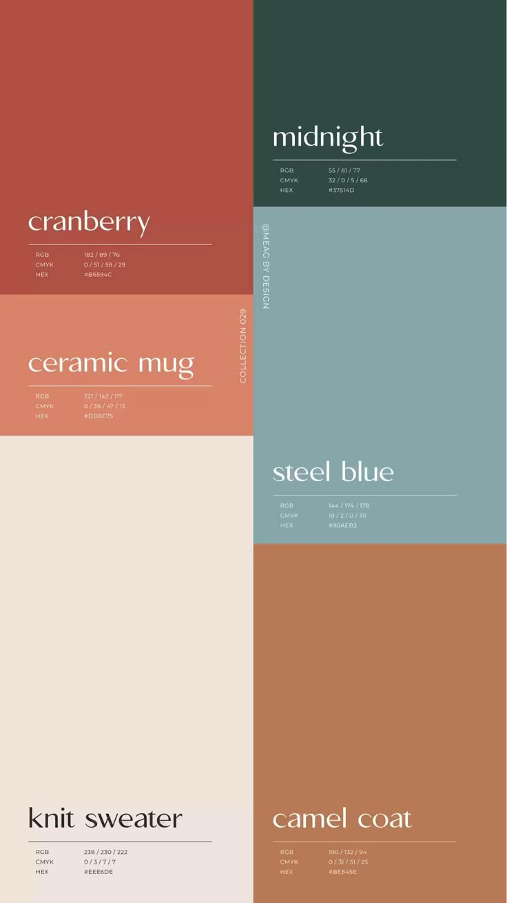

# Mobile App Flow

This is a description of what the app should be able to accomplish from beginning to end. I might forget some things that I have listed in the readme - if I did, infer them in the plans.

## Design Recommendations

I want it to have this color palette:

{width="485"}

I also want it to be very beginner chef friendly. Pinterest is a good UI to go off of for this app, as I wnat it to mimic that type of UI and functionality, mimicing all of the frontend JS and CSS styling.

## User Initialiation

The user will be met with a typical sign in or create user menu. It needs to use firebase and just connect their google account with it so they don't have to login with their own user/password. When creating an account for the first time, it will ask for their first and last name, and then it will have a cute visual with fireworks and stuff (you should think of a different thing but similar to this) and a celebration saying "Account Created! Hello, *first_name*!" and then it will smooth transition to "Let's get started." I want it to feel like initializing an apple product, actually lol. The app will keep them logged in, but after not using it for a few weeks it should ask them to log back in. It will then ask for details about their account on separate screens with smooth transitions in between, like the following:

(each bullet will be separated by a transition) - Personal Address and phone number - (using the personal address to refine store search near them), ask for stores near them. This will offer a search bar and a map so they can select the sores that are near their location. (maybe leverage google maps for this? idk). They can select up to three stores they like shopping at for groceries (for convenience of compute later). - Ask for preferences. "Tell me: What types of foods are you most interested in cooking? Select all that apply" and then have a selection with boxes of different types of cuisine (fast, chinese, italian, american, etc.) I want this to guide the search/planner later, not be deterministic. In other words, I don't want their preferences locking them out of certain foods unless they select an checkbox saying "I would like to make recipes based only from these preferences" or something like that that would be user friendly. - transition to "Great!" "Now we need details about your kitchen" Then ask them to select from a bunch of different tools in their kitchen with instructions on how to do so. I want this section of initialization to be a game - they can swipe left if they have it, swipe right if they do not. it should have an undo feature, and it should also have the option to finish swiping whenever they would like to. With every appliance, I want it to save it to their account just like all of the other data involved in this. Also it should include an image of each kitchen appliance just to make sure they know it by how it looks, and also it should start with the most used (or common) kitchen appliances first and work its way down. I should probably provide a list of kitchen appliances for you to do that, so I'll come up with that later and title the file "kitchenAppliances.csv" or something like that - After they finish with that, it should say "Thank you! Your kitchen is almost done." "Finally, we need details on what spices you already have." "Would you like to help us with your spices? This will refine your recipes and shopping " Yes/Maybe later - Finalizaation script: "Your kitchen is ready! Let's get cooking!"

## Application Features

Once the user opens the app, it will have a menubar on the bottom for them to select the application feature they need. The features are listed in subheadings below. This will mirror the menu on Robinhood's mobile application, or Facebook's top menubar.

### Find Recipes - Chatbot assisted searchbox

frontfacing UI mimics ChatGPT menu style chat

Using an LLM as a search aid, searches for recipes based on known tools, spices, and a main ingredient listed. User can specify ingredients, cuisine type, measurement type (cups/tsp/tbsp, mls, weight, etc) and should list how much time they have to cook (30mins, 60mins, 90mins, 120mins, 120+). It then searches the intenet for best rated options. Later, when they have preferences for previous recipes, it can search for recipes with ingredients they have liked before. The search tool will weigh their preferences, the ratings of the recipe, novelty (how many times they've cooked it or something similar recently) and the time to offer one recipe after the other. The user will, (similarly to dating apps or the spice/appliance inventory tool during initialization), swipe left or right on different recipes that appear so that they quickly choose somemthing they'd like to eat.

It will then create a very easy-to-follow recipe, first with the ingredients or the quantities (each ingredient adjustable from their default choice of weight to mls to cups/tsp/tbsp so it's easy to follow along), then with easy steps. Make sure to follow the recipe soecificaitons exactly though - do not change anything about it. The problem this addresses is that its really hard to choose a recipe you think you'd enjoy, have time for, and have ingredients for. It also removes all of the bloat and commplexity you have to scroll through to get to the actual recipe on recipe sites. It should include images to help the chef understand more context if available. Then the user has the option to save the recipe or rate it later (maybe the next day, maybe to be used in the calendar planner).

Later, the calendar will use this functionality to choose recipes. When choosing a recipe, the app should ask which ingredients you need or already have, and the user will check checkboxes on whether they have it or need it. it will prompt "Do you have the ingredients?" then lists the ingredients, green circle check means yes, red circle x means no. Make it colorblind friendly too.

### Calendar - meal planning calendar tool

This section will show a cute calendar style that mimics Google Calendar, but isn't as complex. By default, it will just show the recipes for dinner, but they should have the options to include breakfasts and lunches too - lunch and breakfasts will have to wait for later development.

The calendar should show the next month (4 weeks) worth of days/meals. They can have the option to go through month by month, seeing previous recipes too. In every box on the calendar, the user should be able to click on the day and see the recipe made previously. For current/future days, the user shoudl be able to tap on it and see two options - if the user has chosen a recipe for that day (or preciously planned it), then it will show the recipe and also have an option to pick a new one. IF they choose to pick a new one, it will then go through the left/right swiping sequence until they select the recipe they like. This will also be based on everything above that the search engine weighs, especially novelty or recency.

The calendar will also have an "Meal Prep" feature. In this, they should be able to specify their budget and desired store to shop at. Then, after factoring the spices and stuff they already have, it will simultaneously pick recipes based on everything about the user's data and based on the affordability of the budget and what they need to shop for. It will simultaneously search that store's inventory and pricing and compare it to recipes it wnats to select to optimize both the recipe search tool and the budget based on the amount of time they want to plan for. If this desn't make sense, tell me and we can sort out the details.

### Your Recipes - Recipes that were favorited, saved, or have a 10/10 satisfaction rating

This is pretty stragiht forward - this will house previous recipes you've absolutely loved, and have a separate tab for recipes youve wanted to try. It will list them in a very friendly, pinterest type of menu so they can enter each recipe based on a photo of that recipe.

### Profile - Edit user settings

Users should be able to edit the following:

- personal address

- phone number

- store preferences

- kitchen appliance inventory

- spice inventory

- Preference history