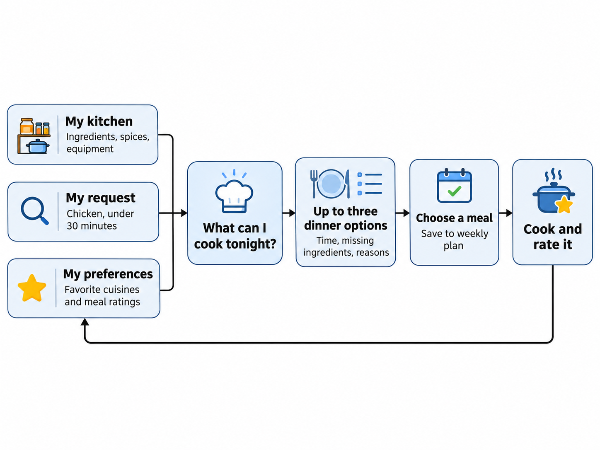
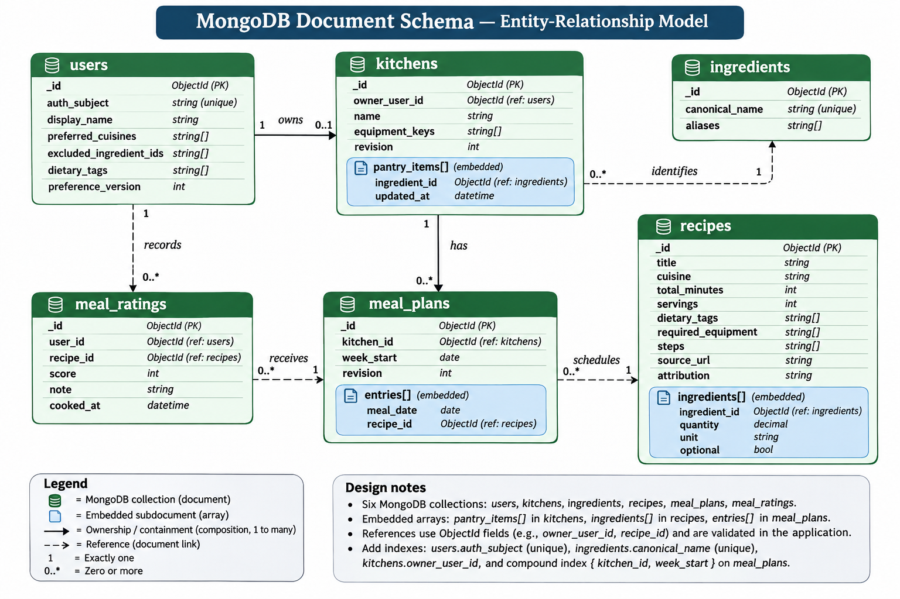
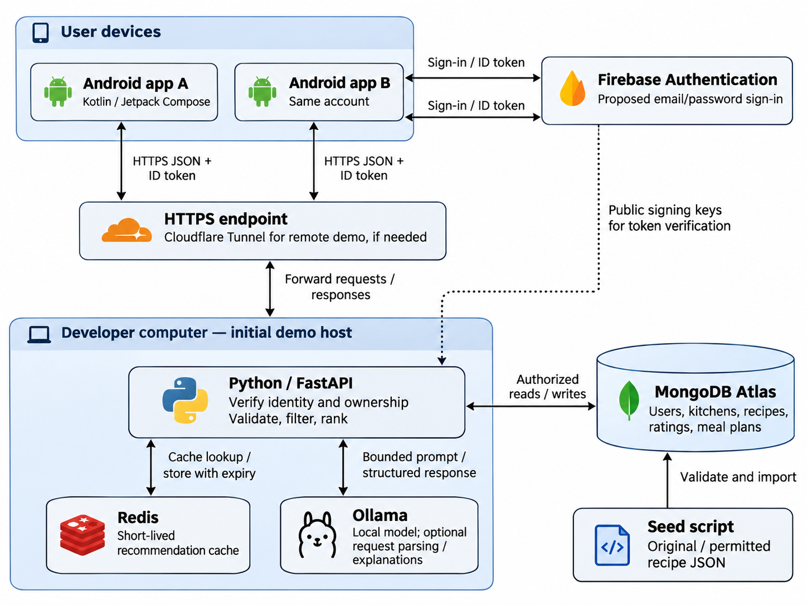

# Initial Project Design

CS 452: Database Modeling Concepts

## Purpose and goals

**My Kitchen is a free Android app that helps people decide what to cook using the ingredients, spices, and equipment they already have.** A user enters a main ingredient and available time, gets up to three suitable dinner options, and can save meals to a weekly plan and rate them afterward. Stored preferences and meal history help future suggestions fit the user's tastes and avoid repetition.

I want to build this because choosing dinner can take longer than cooking it. Recently I spent about 30 minutes finding a teriyaki chicken recipe, then still needed a store trip for ground ginger. My goal is to make those missing ingredients visible before someone commits to a recipe, and make dinner decisions faster for students, individuals, and families.

------------------------------------------------------------------------

{width="822"}

------------------------------------------------------------------------

The first version succeeds if a user can save a kitchen, receive useful suggestions from real stored recipes, understand what is missing, save a dinner, and see that data after signing in on another Android device.

## Scope for the class project

The class project has a 30–40 hour budget. I will build one complete dinner-selection workflow before expanding the original monthly meal-planning idea.

#### Behaviors: First Priority

- Android UI in Kotlin with Jetpack Compose; email/password sign-in using a managed authentication provider.

- One personal kitchen per account: edit ingredients/spices on hand, equipment, cuisine preferences, and dietary exclusions. The same account can use multiple devices.

- Search a small seeded catalog of about 20–30 recipes by main ingredient and maximum total time; show up to three ranked results with missing ingredients and equipment.

- Save selected dinners to a simple seven-day plan; record a 1–5 rating and optional note after cooking.

- MongoDB persistence and a Redis recommendation cache, with explicit handling of stale data and concurrent edits.

- Use a local Ollama model to interpret a short request into editable search fields and expslain validated matches. Ordinary filters remain usable when the model is unavailable.

- Web Scraping to generate best recipies

#### Secondary Priorities

- Automatically fill a week, produce a missing-ingredient shopping list, or import recipes from one permitted source.

- iOS support

- Shared household flags

- Monthly budget optimization

- Location-specific store prices

- Macro tracking

For the first version, pantry tracking means **on hand / not on hand**. The goal is to account for enough quantity for a recipe or automatically subtract ingredients after cooking, but that may have to wait in production. Specific equipment can be stored, and the LLM will interpret the tools before recipe search.

### Example experience

``` text
MY KITCHEN                    TONIGHT'S DINNER
On hand:                      Main ingredient: chicken
  chicken, rice, broccoli     Maximum total time: 30 min
  soy sauce                   [Find dinners]
Equipment:
  stovetop, skillet           Chicken & broccoli rice bowl
                              25 min | Missing: ginger
                              Uses chicken, rice, broccoli
                              [View recipe] [Add to Tuesday]

WEEK                          AFTER COOKING
Tue: Chicken rice bowl        Rating: 1  2  3  4  5
Wed: [Choose dinner]          Note: "Less sauce next time"
```

## Initial ERD

This is a **logical model**: boxes describe entities and arrows describe relationships, even when an entity will be embedded in a MongoDB document. `PK` identifies an entity; `FK` means an application-managed reference, not a MongoDB foreign-key constraint. A user can exist before kitchen setup is finished.

------------------------------------------------------------------------

{width="822"}

------------------------------------------------------------------------

### MongoDB document design

| Collection | Embedded data and references | Reason |
|------------------------|------------------------|------------------------|
| `users` | Authentication subject, display name, preference arrays, preference version. | Load a user's search preferences together; passwords stay with the authentication provider. |
| `kitchens` | Owner reference, equipment array, `pantryItems[]`, revision. Pantry entries reference canonical ingredient IDs. | A small personal kitchen is normally read together; one document allows atomic pantry edits and revision changes. |
| `ingredients` | Canonical name and aliases. | Match “scallion” and “green onion” consistently; avoid separate pantry identities for synonyms. |
| `recipes` | `ingredients[]`, steps, equipment, dietary metadata, source URL/attribution. Ingredient entries reference canonical IDs. | Display one recipe without assembling its instructions from several collections. |
| `mealRatings` | User and recipe references, score, note, cooking date. | Meal history can grow without expanding the user document indefinitely. Multiple cooking events may rate the same recipe. |
| `mealPlans` | Kitchen reference, week start, at most seven dated `entries[]`, revision. | One dinner per day, fetched and edited as a weekly unit. |

Embedded pantry entries are unique by ingredient ID within a kitchen; embedded plan entries are unique by date within a plan. The API validates these rules and checks referenced IDs before saving. MongoDB schema validation will enforce basic types and required fields; the API handles ownership and cross-document rules. Recipes and canonical ingredients will not be deleted through the first-version UI.

Initial indexes: unique `users.authSubject`, unique `kitchens.ownerUserId`, unique `ingredients.canonicalName`, unique `(kitchenId, weekStart)` on meal plans, and `(userId, cookedAt)` on ratings. Start recipe filtering with `ingredients.ingredientId`; inspect actual queries before adding more indexes. A small catalog can be ranked in Python after candidate retrieval.

### Recommendation rules

1.  Normalize pantry and request ingredient names to canonical IDs; ask the user to resolve unknown names. The user can review fields extracted from chat before searching.
2.  Filter recipes by requested main ingredient, total time, equipment, explicit ingredient exclusions, and declared dietary tags. When a dietary filter is active, recipes with insufficient metadata are excluded.
3.  Rank eligible recipes by required-ingredient coverage, cuisine preferences, the user's previous ratings, and a penalty for recently cooked meals. Start with a simple documented weighted score; tune it using a few examples.
4.  Return up to three options with a computed missing-ingredient list. Label them “all required ingredients on hand” or “needs ingredients.” If none qualify, explain which filters to adjust. Do not silently relax exclusions or invent extra results.
5.  Optionally ask Ollama to explain the selected recipe IDs using supplied facts. Validate the output against those IDs; render the original recipe instructions and computed missing list.

The catalog will start with original recipes or material whose reuse is permitted, with source and attribution fields recorded. This avoids making an external search or scraping integration a prerequisite for the demo. Catalog-wide “highest ratings” are deferred; initially the app knows only its own users' meal ratings.

## Rough system design

Kotlin/Android, MongoDB, Redis, and local Ollama preserve the direction of my pitch. Python/FastAPI and Firebase Authentication are proposed additions to make the backend and sign-in concrete. The repository already contains a Python scaffold. I will validate those integrations early and revise this design if needed.

------------------------------------------------------------------------

{width="822"}

------------------------------------------------------------------------

Cloudflare is an optional network entry point here; Firebase supplies application sign-in. The API verifies Firebase ID tokens and maps their subject to a user, then derives kitchen ownership on the server. Knowing another kitchen's ID does not grant access. Database credentials, Firebase service credentials, Redis, and Ollama remain server-side. Local development can connect directly to the API; remote devices require the HTTPS endpoint and a running host.

## Initial daily goals

This plan runs from November 21 through December 3, 2026, using my final project presentation time as the planning horizon.

These are estimated hours, not completed log entries. The existing README records **2.5 completed hours**. This schedule adds **29.5 planned hours**, for **32 hours total**, with up to 3 additional hours available for integration problems (35 total).

## Project Schedule

| Date | Hours | Goal and Evidence of Completion |
|----------------------------------------------------------------------------|----------------:|------------------------------------------------------------------------------------------------------------------------------------------------------------------|
| Nov 21–23 | 4 | Refine scope, ERD, architecture, and schedule. Publish initial-design Markdown. Review the design with a peer/TA (1 collaboration hour). Create Android and FastAPI skeletons and demonstrate connectivity through a health endpoint. |
| Nov 24–25 | 5 | Implement Firebase authentication and API token verification. Connect MongoDB Atlas, define schemas and canonical ingredient IDs, and seed 20–30 recipes with attribution. Implement kitchen and preference endpoints with ownership checks. |
| Nov 26 | 0 | Thanksgiving break. |
| Nov 27–28 | 6 | Build pantry, equipment, and preference screens. Implement recipe filtering, ranking, and missing-ingredient results. Connect Android search, results, and recipe detail screens. Demonstrate saving user data and searching for recipes. |
| Nov 29–30 | 6 | Implement weekly meal plans, revision conflict handling, meal ratings, and preference-based ranking. Integrate Redis caching and verify invalidation and failure handling. Spend 1 hour getting/giving peer feedback and recording changes. |
| Dec 1 | 4 | Timebox Ollama integration for request extraction and recommendation explanations. Test the complete workflow with a peer (1 collaboration hour), including two devices and separate accounts. Resolve major issues and freeze features. |
| Dec 2 | 3 | Finalize setup instructions, record a short demo, and document performance and system tradeoffs. Complete the final report, including diagrams, at least three learnings, AI use, personal motivation, and collaboration documentation. |
| Dec 3 (Deadline) | 1.5 | Buffer for final fixes. Verify public Markdown and demo links, finish actual-hours log, publish the class-channel post, and submit all required materials. |
| **Planned Remaining** | **29.5** |  |
| **Already Completed** | **2.5** |  |
| **Total Planned Hours** | **32** | Optional integration buffer of up to 35 total hours. |

After each work session I will record the actual date, work, and hours in the [project log in README](README.md#hours-spent-on-project), then commit and push that entry.