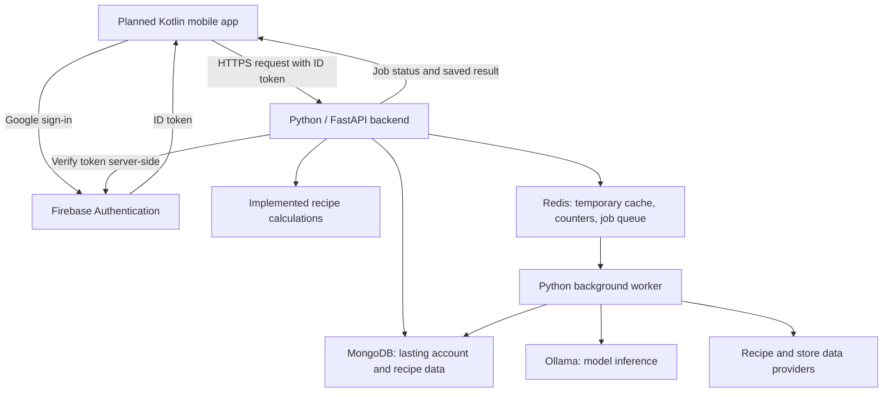

# Developing My Kitchen

`AppFlow.md` defines the current experience. `README.md` supplies the original goals. `INITIAL_DESIGN.md` is historical and needs revision where it conflicts with the flow. This guide describes implemented behavior separately from future integrations.

The [course-to-app map](COURSE_ALIGNMENT.md) records the November 26 Canvas review, the concepts behind each backend stage, and the actual final-report due date.

## First working milestone

The Python backend can validate a supplied recipe and preview different servings and measurements without changing its instructions or cooking times. It is stateless: it does not save recipes, sign users in, search the internet, or calculate prices yet. The example is development data, not a replacement for internet recipe discovery.

From the project directory in PowerShell:

``` powershell
uv sync --group dev
uv run cs-452-finalproject
```

Keep that terminal running. Open <http://127.0.0.1:8000/docs> to inspect the API and try requests. Stop the server with Ctrl+C. To restart automatically after edits:

``` powershell
uv run uvicorn cs_452_finalproject.api:app --reload
```

In another terminal, make a real request:

``` powershell
Invoke-RestMethod http://127.0.0.1:8000/health
$preview = Invoke-RestMethod -Method Post `
    -Uri http://127.0.0.1:8000/api/v1/recipes/preview `
    -ContentType 'application/json' `
    -InFile .\examples\recipe-preview.json
$preview | ConvertTo-Json -Depth 10
```

Expected: four servings, 32 tablespoons of rice, 946.352946 milliliters of water, and a warning for salt because 'to taste' has no numeric amount to scale. The original ingredient text stays visible for reference. Decimal quantities are JSON strings so precision survives transport; the mobile display will format them as readable fractions or rounded values without modifying the source recipe.

## Follow one request through the code

1.  A future Kotlin screen (or today's PowerShell request) sends JSON to the API.
2.  `src/cs_452_finalproject/api.py` selects the route. FastAPI turns the request into `PreviewRequest` from `models.py`. Invalid fields return HTTP 422 with details.
3.  `recipes.py` multiplies each numeric quantity by target servings / source servings. It then converts requested units, retaining the scaled source unit with a warning when conversion is unavailable. It never asks the model to do arithmetic.
4.  `RecipePreview` describes the response. FastAPI converts it to JSON.
5.  The caller renders the result. This request does not write to a database.

Every handled request also passes through `trace_request` in `api.py`, before and after its route. This is middleware: shared behavior around all routes, described in the [FastAPI middleware guide](https://fastapi.tiangolo.com/tutorial/middleware/). It generates a UUID, measures elapsed time, logs the method/path/status, and puts the same UUID in the response's `X-Request-ID` header. The trace event excludes request bodies, authorization headers, and query strings. Uvicorn's separate default access log may still include query strings; never put secrets in URLs.

Try matching a response to its trace in the running server terminal:

``` powershell
$response = Invoke-WebRequest http://127.0.0.1:8000/health
$response.Headers['X-Request-ID']
```

Validation errors (422) and missing routes (404) also receive an ID. Unexpected server exceptions log an ID and traceback, but their generated 500 response does not currently include that header. Extending error handling is a later step.

Set breakpoints in `api.py`'s `preview` function and `recipes.py`'s `preview_recipe`. Start the module `uvicorn` with arguments `cs_452_finalproject.api:app` using the project `.venv` Python interpreter in your editor's debugger. Omit reload while learning breakpoints so there is only one server process.

Useful experiments: change `target_servings` in the example to 6; change the first target unit from `tbsp` to `g` and observe the density warning; set servings to zero and read the 422 response. Put an intentionally misspelled field into the request: validation should reject it instead of silently ignoring it.

## Where to change things

| Change | Starting point |
|------------------------------------|------------------------------------|
| Recipe fields or validation | `src/cs_452_finalproject/models.py` |
| Scaling and conversion behavior | `src/cs_452_finalproject/recipes.py` |
| URLs, request/response handling | `src/cs_452_finalproject/api.py` |
| Default local server host/port | `src/cs_452_finalproject/__init__.py` |
| Dependencies | `pyproject.toml`; update the lockfile with `uv sync` |
| Reproducible example request | `examples/recipe-preview.json` |
| Regression checks | `tests/test_recipe_preview.py` |
| Match a response to server logs | `api.py` middleware; `tests/test_request_tracing.py` |
| Refresh local course reference | `scripts/review_canvas.py`; see `COURSE_ALIGNMENT.md` |
| Product behavior and visual direction | `AppFlow.md`, `README.md`, `colors.jpg` |

Run checks after changing calculation or API behavior:

``` powershell
uv run pytest
uv run ruff check .
uv run ruff format --check .
```

## Service connections

Only the API and calculation module below exist today. All other boxes describe the planned architecture; `/health` explicitly lists them as `not_connected`.



- **Kotlin** implements screens, gestures, local UI state, and eventually an outbox of unsynced edits. Android and iOS clients use the same backend. Firebase sign-in supplies an ID token; the phone sends it on authenticated API requests.
- **FastAPI** receives requests, verifies identity, checks ownership, validates data, and calls business logic. Clients will not receive database credentials.
- **MongoDB** stores lasting account, kitchen, recipe, calendar, and history records. A UI reset or expired Redis cache must not delete those records.
- **Redis** supports temporary data and queued jobs. A separate Python worker must actually execute each job. Retry rules must avoid duplicating writes.
- **Ollama** runs the model. The model may interpret requests and propose candidates; Python checks constraints and calculates quantities and prices from supplied data.
- **Recipe/store providers** supply external facts. We must verify an actual source before promising ratings, image reuse, inventory, or branch-specific prices.
- **Cloudflare**, if used, provides the public network entry point. Firebase remains responsible for the Google account sign-in described in the final flow.

The eventual response path is not always a queue: ordinary reads and short edits can go directly through the API to MongoDB. Slow plan generation returns a job ID; the app checks status while a worker produces and saves the result.

## Debug by locating the failing boundary

| Symptom | First check |
|------------------------------------|------------------------------------|
| Server cannot start | Run `uv sync --group dev`; read the terminal traceback. Check port 8000 is free. |
| API unreachable | Request `/health` locally. A phone's `localhost` refers to the phone, not this computer. |
| HTTP 422 | Read `detail`: field locations explain what input failed validation. |
| Unexpected quantity | Compare source quantity, servings ratio, source unit, target unit, and density in `recipes.py`. |
| Conversion warning | A count or weight/volume change may lack the information needed to convert. |
| Cloud feature absent | This milestone intentionally reports `not_connected`; a successful health check is only API liveness. |

For a future Android emulator, the host computer is normally reachable at `10.0.2.2`; the client development configuration must also allow its local HTTP connection. Real-device access requires an explicitly configured network endpoint. Today's server binds only to loopback. Do not expose this development foundation as a production account service: authentication and persistence are not implemented.

## Build order and remaining decisions

1.  **Done in this milestone:** local API, recipe input contract, serving/conversion preview, example request, calculation/API tests, and this guide.
2.  **Mobile setup and connectivity:** install Android Studio/JDK/SDK, create the Kotlin client, implement the palette/theme and API health/preview connection. Check the multiplatform setup before treating iOS as delivered; Apple builds need macOS/Xcode.
3.  **Account and kitchen:** Firebase Google sign-in, server-side token verification, MongoDB persistence, onboarding/profile screens, logout/deletion, and ownership tests.
4.  **Recipe workflow:** private manual recipes, permitted URL import/search integration, recipe cards and gestures, saves/likes/ratings, and personalized ranking. Preserve source attribution. Keep Add Recipe within Your Recipes unless the user chooses a fifth navigation tab.
5.  **Calendar:** planned/cooked/skipped states, movement with save/cancel, history, shopping lists, per-meal servings, and edits across devices.
6.  **Planning:** verify one store's usable data, then combine shopping quantities and package costs, candidate adjustment, plan approval, scheduled shopping days, and explicitly labeled unavailable/estimated prices. Add Redis workers and Ollama at the workflows where they are needed. Preserve the full goal in AppFlow.md.

Assumptions to revisit: unit names `cup`, `tbsp`, and `tsp` currently mean US customary volume; density is a supplied ingredient-specific value, not discovered by this API; preview serving counts are whole numbers from 1 to 1000. The input model follows selected schema.org concepts but full JSON-LD import/export is not implemented. Recipe publication, inactivity timeout, pricing sources, pantry quantity/reservation rules, and calendar month versus rolling four weeks still need concrete decisions when implementing those features. These do not block the current calculation module.

Your flow's troubleshooting reset must eventually distinguish UI/cache refresh from unsynced edits: upload or retain edits in a durable local outbox before clearing transient UI state. That behavior is not implemented by this stateless backend.

## Reference documentation

- [FastAPI first steps](https://fastapi.tiangolo.com/tutorial/first-steps/)
- [FastAPI testing](https://fastapi.tiangolo.com/tutorial/testing/)
- [Schema.org Recipe](https://schema.org/Recipe)
- [NIST conversion factors](https://www.nist.gov/pml/special-publication-811/nist-guide-si-appendix-b8)

Keep this guide updated as each real integration lands so it remains an accurate map of the code you can inspect, rather than a list of promised capabilities.

## Verification on November 26, 2026

- `uv run pytest`: 16 tests passed, including calculation/API behavior and request ID correlation, input exclusion from trace events, and validation/not-found IDs.
- `uv run ruff check .` and `uv run ruff format --check .`: passed.
- `git check-ignore .local/canvas-course.json`: confirmed the private course snapshot is excluded. The course refresh fetched nine modules, 71 assignments, and 19 pages; see `COURSE_ALIGNMENT.md` for unavailable material.
- The installed Starlette test client emits one dependency deprecation warning about its httpx adapter; tests currently pass. No live mobile, Firebase, MongoDB, Redis, Ollama, recipe-search, or store-pricing connection was verified in these tests.
- On this Codex Windows host, sandboxed uv cache access failed and HTTP client tests stalled; the successful final checks ran outside that sandbox. This is a tooling limitation observed here, not evidence that remote services are configured.