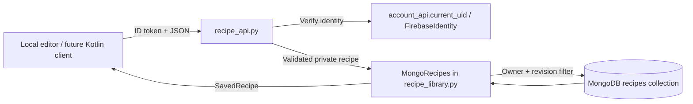

# Private manual recipes

This milestone implements the manual-entry part of AppFlow's Recipe Maker and
Your Recipes. A Google-signed-in user can create, list, read, and edit private
recipes in MongoDB. The local development client provides an editor and small
photo-card list. The final Kotlin interface, internet discovery/import, publishing,
bookmarks/loved tabs, ratings, and calendar selection remain future work.

## Try it in the local client

1. Open <http://localhost:8000/dev/sign-in>, refresh to load the updated client,
   and sign in with Google again. This helper keeps sign-in in memory, so a page
   refresh requires another login; your stored account is not erased.
2. Under **Your Recipes**, click **Add a recipe**. Enter your recipe's name,
   servings, preparation/cooking times, ingredient names and original wording,
   numeric amounts/units where known, and one instruction per line.
3. Optionally add equipment, cuisine, description, source link, photo link, and
   a whole-recipe cost estimate/currency. Cost is entered by you, not a store quote.
4. Click **Save private recipe**. The form becomes an editor for the saved recipe;
   subsequent saves update it instead of creating duplicates.
5. Reload the recipe list, select **View / edit recipe**, and verify the stored
   ingredient wording and steps. Sign out/in or restart the API to check persistence.

Photo URLs are displayed by the browser with no referrer; the server does not fetch
or upload photos. A source URL is attribution only; it is not imported. A failed
photo load leaves a usable text card. The editor handles the first photo URL and
preserves any additional URLs already stored. A numeric amount is optional for
"salt to taste" and must be positive when provided. Source text remains separate
from structured quantities so conversion/serving previews need not rewrite it.

Profile and kitchen controls remain independent of recipe edits. The helper keeps
fields it doesn't expose (such as an ingredient's existing density). Closing or
switching editors asks before discarding the form. Conflicts/errors leave entered
values in place; they do not overwrite saved records automatically. Reloading the
page itself currently loses unsaved recipe edits; a durable device outbox is later work.

## Endpoints and ownership

All library endpoints use the same verified Firebase Bearer identity as accounts.

| Method and path | Behavior |
|---|---|
| `POST /api/v1/recipes` | Create a private recipe with a client request UUID. Returns 201, including on an identical retry. |
| `GET /api/v1/recipes?offset=0&limit=20` | List only your recipes, newest first, with `next_offset` or null. Limit is 1–50. |
| `GET /api/v1/recipes/{id}` | Read your saved recipe and revision. |
| `PUT /api/v1/recipes/{id}` | Replace that recipe using `expected_revision` and the full recipe data. |
| `GET /api/v1/recipes/{id}/schema` | Owner-only schema.org Recipe JSON-LD export. This does not publish the recipe. |

The existing `POST /api/v1/recipes/preview` still calculates servings/conversions
without saving. Send a saved record's `recipe` and desired servings to that route.

The API derives `owner_uid` from Firebase; callers cannot provide or change it.
Every MongoDB read/list/update filter includes that owner. Another user's ID gets
the same 404 as a nonexistent recipe, including the export endpoint. `public`
visibility is rejected in the private creation/update model. A publishing flow
needs separate access and confirmation behavior later.

Creation doesn't require a completed onboarding profile. A verified user owns
their recipes even while their kitchen setup is incomplete.

## Request path and files



- `models.py`: recipe/ingredient fields shared with serving/conversion previews.
- `recipe_library.py`: private request/response contracts, database operations,
  duplicate-retry handling, and schema.org mapping.
- `recipe_api.py`: authenticated route definitions and bounded list parameters.
- `services.py`: shared MongoDB connection pool. Recipe storage reuses it.
- `dev_web/sign-in.html`, `.js`, `.css`: temporary client editor and library cards.
- `tests/test_recipe_library.py`: security, retry, conflict, export, pagination,
  validation, outage, and persistence-contract tests.

Put breakpoints at `create_recipe` and `MongoRecipes.create`. Inspect the verified
UID and the owner-filtered query, without printing token/password values. Then
step through `recipe.model_dump(mode="json")`: URLs, units, and Decimal amounts
become BSON-compatible values. Decimal quantities/costs are deliberately stored
as strings for precision and reconstructed by the Pydantic model on read.

## MongoDB document and retry rules

`recipes` is separate from `accounts`; a growing library must not expand the
bounded kitchen/account document indefinitely. Each record contains `_id`,
server-derived `owner_uid`, its own `revision`, server creation/update timestamps,
the recipe, and an internal creation-payload hash. Owner/hash fields aren't
returned by the API.

The first access creates an index on `(owner_uid, created_at descending, _id
descending)` for owner-scoped list queries. The built-in `_id` index is unique.
Document writes are atomic; replacing a recipe does not require a transaction
with the account document. Recipe revisions are independent from account revisions.

For creation, the client generates `client_request_id` once per draft and keeps it
for retries. The server derives a stable recipe ID from that UUID and the verified
owner, then inserts it. An identical retry returns the existing recipe. Reusing
the same request ID with different creation data returns 409. The helper retains
the request ID after an ambiguous creation failure: retry unchanged input first.
Different new recipes must use different request IDs. The server keeps the original
creation hash even after later edits, so a delayed retry cannot reset an edited recipe.

Updates filter by `_id`, `owner_uid`, and `expected_revision`, incrementing the
revision in the same write. A stale save gets 409; fetch/review the latest record
and deliberately reapply edits. No automatic overwrite/retry happens in the UI.
Pagination uses bounded offsets; adding recipes while paging can shift page
boundaries. Reload the list to see a consistent latest ordering in this first version.

## Schema.org relationship

AppFlow requests schema.org Recipe. Internal validated fields support calculations;
the owner-only export maps them to [schema.org Recipe](https://schema.org/Recipe):

| Internal field | Export |
|---|---|
| `title`, `description` | `name`, `description` |
| `servings` | `recipeYield` |
| Original ingredient wording | `recipeIngredient` |
| Ordered `steps` | `recipeInstructions` / `HowToStep` |
| Preparation/cooking minutes | ISO duration `prepTime`, `cookTime` |
| `image_urls`, `cuisine` | `image`, `recipeCuisine` |
| Equipment | `tool` / `HowToTool` |
| Optional manual cost/currency | `estimatedCost` / `MonetaryAmount` |
| Original recipe source | `isBasedOn` |

This is not a universal schema.org importer. It doesn't invent nutrition, public
ratings, total elapsed time, or source details. The library's cost estimate describes
the ingredients consumed by the whole recipe, not today's grocery checkout cost.

## API example

With a real user token privately available in `$env:FIREBASE_ID_TOKEN`:

```powershell
$authHeaders = @{Authorization = "Bearer $env:FIREBASE_ID_TOKEN"}
$draft = Get-Content examples/private-recipe.json -Raw | ConvertFrom-Json
$draft.client_request_id = [guid]::NewGuid().ToString()
$body = $draft | ConvertTo-Json -Depth 12
$saved = Invoke-RestMethod -Method Post -Uri http://127.0.0.1:8000/api/v1/recipes `
    -Headers $authHeaders -ContentType application/json -Body $body
Invoke-RestMethod -Uri "http://127.0.0.1:8000/api/v1/recipes/$($saved.id)" -Headers $authHeaders
```

Repeat the same POST/body to test idempotency. For PUT, send
`{"expected_revision": <saved revision>, "recipe": <full recipe>}`. Don't put
tokens or credentials into example files or URLs.

## Verification

On November 27, all 41 Python tests, lint/format checks, and JavaScript syntax
checking passed. The production repository was also exercised on **real Atlas**
using the separate `recipe_verification` collection: creation, duplicate retry,
reading from a new connection, competing writes (one success and one 409), and
owner isolation passed. One fixed synthetic fixture remains there; no real user
account or recipe was changed by that check.

To rerun that opt-in write check:

```powershell
uv run python scripts/check_recipe_storage.py --write-test-record
```

This check proves database behavior, not client Google login. Browser inspection
separately confirmed the user's real Google sign-in loaded their account from
MongoDB. After restart, a fresh browser page showed Your Recipes with controls
correctly disabled until login. The new recipe UI still needs a signed-in create/
save check after refresh; the repository-only Atlas tests do not establish that.
